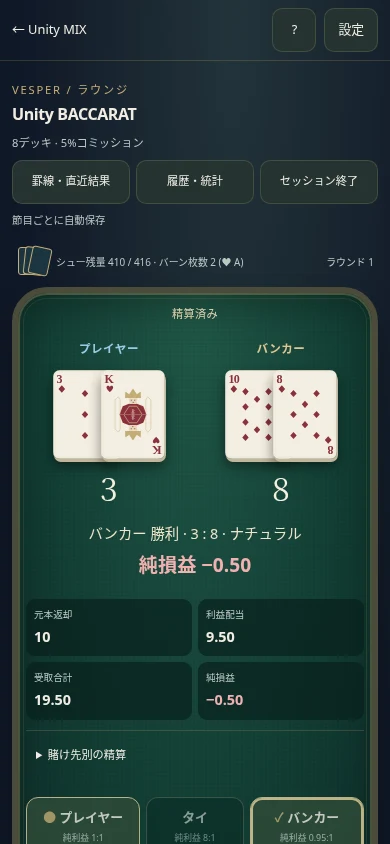
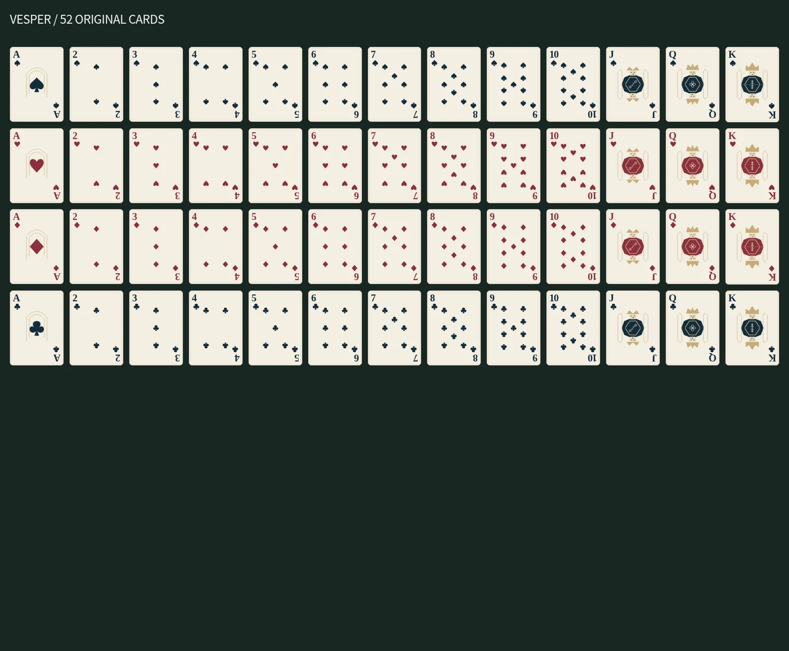

[最新：以前のカジノ風デザインへ戻した版](classic-return/README.md)。全方向の絞り・操作性は維持しています。

全方向の絞りと、緑・金のカジノ卓へ更新しました。[最新の画面・動画・検証](omni-casino/README.md)。

# 現在のバカラ：Unityオリジナルテーブル

既定入口 `/baccarat/index.html` は独自デザイン・直接絞り・チップ先行操作へ更新しました。[実装・画面・動画・検証](salon/README.md)。前の再現版は `/baccarat/classic.html`、VESPERは `/baccarat/vesper.html` に保管しています。以下は過去の段階の記録です。

# Unity バカラ：参考準拠版

最新の既定入口は `/baccarat/index.html`。参考サイトの許諾済み素材と配置を使う版です。[比較・検証記録](faithful/README.md)を参照してください。

以前のVESPERは `/baccarat/vesper.html` に保存されています。進行・残高は同じSession保存を使用し、既存のレトロ、交流ゲーム、チンチロ、シューティングは維持しています。

---

以下は保存したVESPER版の記録です。

# Unity BACCARAT / VESPER

Unity MIXのホームから入る、登録・ルーム作成不要の1人用ブラウザゲーム。ユーザーの追加指示により、Windows向けUnityネイティブ案から**スマホ中心のWeb版**へ変更した。Unity Editor/C#のプロジェクトやWindows実行ファイルではない。

## 大判カードの直接操作（最新）

カードの端を指でつまんで上へ動かす、全画面の卓へ更新。左右の角、覗き戻し、保持、素早いめくりに対応。補助バーは閉じた補助操作内にあります。通常卓のカードも拡大・第三カードは横置き。[仕様・画面・検証](HAND-TABLE-PLAN.md)。

## 絞り・希少予告の追加

指で開く最後の一枚、途中保留・復帰、青/緑/赤/レインボー予告、扉/封印/星光/静寂のカットイン、独立音量、5スタイルに対応。[演出仕様と操作](PRESENTATION.md)。色予告は純損益プラス限定で、抽選・精算には影響しない。

## 実装済み

- 8デッキ416枚、5%コミッション方式プントバンコ。P→B→P→B、ナチュラル、正式な第三カード規則。
- オリジナルSVGの52枚、共通の180度対称裏面。A/J/Q/Kは専用の幾何学デザイン。カードのタップ拡大。
- 3テーブル。外観とベット帯のみ異なり、ルール・配当・確率の裏補正は共通でなし。
- ベット、取り消し、全解除、前回ベット、倍額、上限/残高検査。
- 元本返却・利益配当・受取合計・純損益を分離。複数箇所へのベットも個別明細を表示。
- 通常・クイック・短縮、動き軽減（端末設定も尊重）、控えめなオリジナル合成音。音楽・効果音・操作音の個別音量。
- 3段階の操作チュートリアル。明示した固定シューで学ぶ。通常の残高・保存へ反映しない。
- ビーズプレート、大路、直近結果、履歴、純損益別成績、勝敗集計、累計収支、最大ドローダウン。
- 日本語/英語、文字100/115/130%、画質（影/背景の簡略化）、対応ブラウザの全画面API。
- ローカル保存、検証済みバックアップ復旧、保存失敗時の未確定処理、明示的な保存なし体験。
- 途中終了時は確定済みベットを精算。再開時の二重引き落とし・二重精算を防止。

現金、チップ購入、換金、景品交換、オンライン対戦、アカウント、クラウド保存、ランキングは実装していない。派生罫線とサイドベットも今回の範囲外。

## 遊び方

ホームの「バカラで遊ぶ」→新規セッション→テーブル選択。初回は操作チュートリアルも利用可能。
チップを選び、プレイヤー/タイ/バンカーへ配置して「ベット確定・配札」。結果後に明細を確認し「次のラウンド」。
スマホは縦スクロールが可能。狭い画面や文字拡大では操作部を固定せず、カード・操作が重ならないようにした。罫線はダイアログで開き、カードはタップで拡大する。配札中に設定や他のタブへ移ると停止し、再開操作で続ける。

## ルール

A=1、2〜9は額面、10/J/Q/K=0。合計の下一桁を比較。初期どちらかが8/9なら双方追加なし。
Pは0〜5で引き、6/7で停止。Pが停止した場合、Bは0〜5で引き6/7で停止。

| Bの2枚合計 | Pが第三カードを引いた場合、Bが引く条件 |
|---|---|
| 0〜2 | 全値 |
| 3 | 8以外 |
| 4 | 2〜7 |
| 5 | 4〜7 |
| 6 | 6・7 |
| 7 | 引かない |

| 賭け先 | 純利益倍率 | 元本込みの受取 |
|---|---:|---:|
| P | 1:1 | 2倍 |
| B | 0.95:1 | 1.95倍 |
| TIE | 8:1 | 9倍 |

TIE時はP/Bの元本返却。ベットは整数チップ、残高は0.01チップ単位の安全な整数。5%手数料は丸めなし。JSの金額計算に小数の倍率を直接掛けない。

8×52の固有IDを一様なFisher–Yatesでシャッフル。製品用はWeb Cryptoと棄却法で偏りを避け、検証用seededRandomとは分離。先頭1枚を表示し、その値の枚数を追加バーン（A=1、絵札=10）。カットは末尾14枚前。通過したラウンドを終え、次の配札前に交換。残り6枚未満でも新シューに交換し、ラウンド途中で交換しない。

## 保存と会計

`unity-baccarat-session-v1`、同キー末尾`-backup`、`unity-baccarat-settings-v1`を使用。他ゲームのキーは変更しない。
確定時に実際のシュー順でカードを取り出し、規則で勝敗を求める。結果を先に選んでカードを生成する処理はない。
確定した配札計画・カード消費位置・ベット・引き落としを一つのスナップショットとして保存後に画面へ適用。精算も残高・履歴・精算済み状態を一括保存する。保存失敗時は取引前の状態を保持。
表示上のカード反転進捗だけは毎回保存せず、復帰時に同じ配札を最初から表示する場合がある。カードやベットを引き直さない。

スキーマv1・チェックサム・カード集合・配札規則・残高/精算・履歴の整合を検査。破損時はバックアップへ戻り、通知する。両方を検証できない場合は自動初期化しない。将来の保存版は明示的な移行処理が必要。チェックサムは誤破損検出用で、改ざん防止や競技用の認証ではない。

詳細履歴/罫線は直近500結果。累計統計はセッション全体。罫線はその500結果から再構築するため、長いセッション全体の罫線を永久保持する仕様ではない。新規セッションは前回保存を置換し、その旨を開始前に表示する。

## 構成と起動

追加のnpmパッケージ・有料サービス・環境変数は不要。初回読込や再読込にはサイトへの接続が必要。読込後の遊技・カード・音・保存はローカルで処理し、PWAによるオフライン起動は未実装。

```bash
npm ci
npm start
# http://localhost:3000/baccarat/index.html
npm test
node --expose-gc tools/baccarat-survey.mjs
UNITY_URL=http://127.0.0.1:3000 python test/baccarat_browser.py
UNITY_URL=http://127.0.0.1:3000 python test/baccarat-legacy_browser.py
UNITY_URL=http://127.0.0.1:3000 python tools/baccarat-art-check.py
UNITY_URL=http://127.0.0.1:3000 python tools/baccarat-browser-perf.py
```

Pythonのブラウザ検証はPlaywright・Chromium、画像検証はPillowを使用する。これらは開発検証用で、ユーザーの端末には不要。

- `rules.js`：純粋な点数・第三カード・精算。
- `shoe.js`：カード集合、シュー、乱数源。
- `session.js`：状態遷移、取引、検証、統計。
- `storage.js`：保存・復旧・設定。
- `roads.js`：罫線の独立した座標生成。
- `main.js` / `style.css`：スマホ中心の画面、入力、スケジューラ。
- `audio.js` / `motion.js`：演出のみ。コールバックから残高を変更しない。
- `cards/`：編集可能なSVG、`card-data.js`：同じ素材の生成済みパック。

カード変更後は `python tools/generate-baccarat-cards.py`。52枚のSVGとパック一致をテストする。絵柄はSVG/パック、テーブル配色はCSS、テーブル条件はTABLESで分離。テーブル条件や保存形式を変更する場合は既存保存の移行を検討する。

## 検証

[検証結果と限界](QA.md)、[素材と利用条件](ASSETS.md)、[生データ・画像](qa/)を参照。



