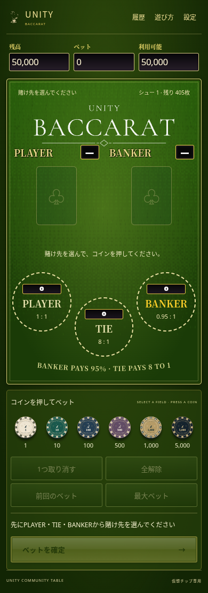
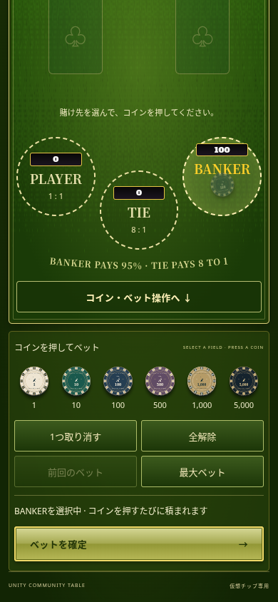
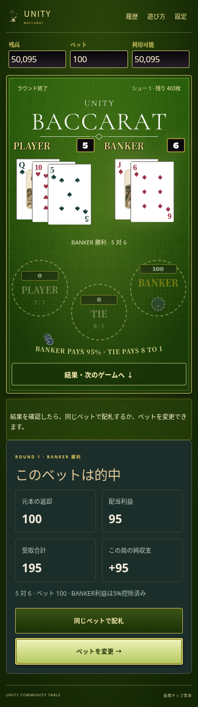

# バカラ UI/UX 実操作監査と改善（2026-11-08）

対象: `http://127.0.0.1:3482/baccarat/index.html`（公開版と同じコミット f8f1859 を基にしたローカル環境）。スマホ相当375×812、390×844、414×896とPC1440×900。Chromium、ソフトウェア描画。物理iPhone/Safari、音の実聴、支援技術での実機検証は未実施。

## 操作手順と評価

1. タイトル→テーブル: 正常。Unity専用カードと緑の卓の一貫性、明確な開始ボタンは維持。
2. 賭け先→コイン配置→確定: 正常だが、初期390px画面では確認ボタンがy=1003〜1052px、画面の高さ844pxの外にある（改善前 `before-bet-390.png`）。各操作ボタンは44px以上。大きなカードと卓を残し、操作へ移るリンクを追加した。
3. 配札→カード公開: 正常。手動しぼりの起動を実操作で確認し `before-round-390.png` に記録。改修後の通し検証は設定画面から自動公開・クイックを選び実施。確定・同額再配札時はスマホのみ卓へスクロールし、配札を画面外で見逃さないようにした。
4. 勝敗→精算→次局: 正常。以前は結果・次局操作を下へ探す必要があった。「結果・次のゲームへ」リンクを卓内に追加。次局で賭け先へ戻す。
5. 履歴・罫線→閉じる: 正常。実ラウンド後の履歴と罫線を確認。
6. 残高不足での同額ベット: 無効操作の理由がtitle属性だけだったため、タッチ端末では理由を確認しにくかった。見える説明とaria-describedbyを追加。テストでは実ラウンド後の残高・前回ベットを意図的に調整した低残高状態を使用。
7. 設定→閉じる: 正常。音量%表示、めくり方と速度の設定は維持。閉じるボタンに「閉じる」の読み上げ名、最小44px幅を付与。

## 優先順位

|順位|確認状況|問題|改善|影響/工数|
|---|---|---|---|---|
|1|実操作・座標確認済み|スマホでコイン操作・確定・結果・次局が縦方向に分散|状態に対応した移動リンク、確定と次局のスマホ向けスクロール|高/小、実装済み|
|2|DOMと低残高UIで確認済み|無効な「同じベット」の理由がホバー依存|タッチでも見える理由と下げる操作への案内|中/小、実装済み|
|3|DOM確認済み|閉じるボタンの表示「✕」だけでは用途の読み上げが不明瞭|明示的な読み上げ名と44px幅|中/小、実装済み|
|4|仮説|PLAYER/BANKER/TIEと配当表記は初見には説明が要る可能性|常時ラベルを増やす前に初見ユーザーテストで確認。既存の遊び方を維持|中/中、未変更|

## 変更ファイルと保護範囲

- `public/baccarat/salon-shell.js`: 操作移動リンク、参照先ID、残高不足の説明。
- `public/baccarat/salon-main.js`: 状態に応じた導線表示、スクロール、無効理由と読み上げ対応。
- `public/baccarat/salon-classic-theme.css`: 移動リンクを既存の緑・金の卓に合わせる。44pxタップ領域。
- `test/baccarat-ux_browser.py`: 上記の実操作回帰シナリオ。

第三カード規則、シュー、賭け金、配当、精算、保存、出目、しぼりの形状と動作は変更していない。自動で精算や再ベットを行う導線は追加していない。

## 検証

- `node --test test/baccarat-*.test.js`: **78件成功、0件失敗**。
- `python3 test/baccarat-ux_browser.py`: 375/390/414/1440px。設定→開始→選択→コイン→確定→自動公開→結果→履歴→次局。横はみ出し、JavaScript例外なし。
- 低残高による再ベット不可の理由表示も確認。履歴と精算値の生成は既存の実際のラウンドを使用。
- `git diff --check` 成功。
- `browser-results.json` に幅別の結果。画像は同ディレクトリ。

