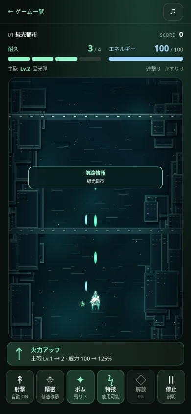
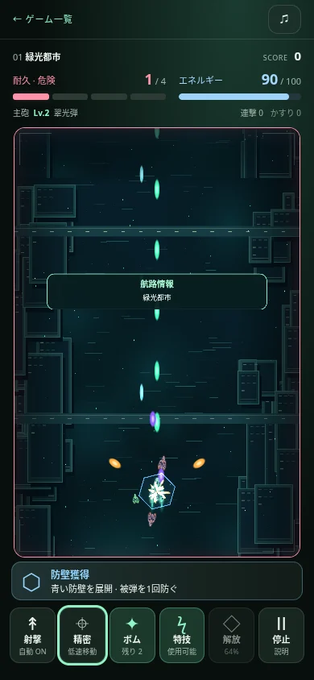

# 認知負荷・補給バランス改修（2026-10-28）

目的：補給の見分け・取得の恩恵・残り耐久・スキル状態をプレイ中に読み取れること。
既存のThree.js・120Hz物理・保存形式を維持し、シューティングの表示を独立改修。

## 方針
- 英字の小型補給から、色＋固有記号＋日本語名の56×64ワールド単位の補給へ。回収判定22は変更しない。
- 上部に耐久の分割ゲージと数値、エネルギーを常設。残り半分は注意色、残り1は危険色。被弾は短い静的な縁取り、画面全体の点滅は追加しない。
- 取得前後の値をコアイベントに記録。連続回収でも途中の値を保持。満タン・最大強化・未知核の正体を明示。
- 下部の固定1枠で直近取得の実際の効果を4.5秒表示。同種の短時間回収は個数集約。停止中に直近3件と全19種の一覧を確認できる。
- ボム残数、特技の待ち時間/必要EN、解放の蓄積率/発動時間を操作ボタンに表示。使用不能時は操作を無効化。
- レトロ風走査線と極小文字中心のメニューから、丸いカード・統一された余白・明快な選択状態へ。

## 追加要望：補給の恩恵
- 主砲威力はレベルごとの基礎比加算11→25ポイント。Lv2は100→125%、Lv8は275%。元からある射線増加・進化条件は維持。
- 連射速度は1段階12→22ポイント（射撃時間刻みにより実効値に量子化誤差あり）。
- 拡幅は従来の通常弾/散弾以外の18武器でも、段階に応じた側射を追加。通常弾は拡幅3段階目も有効に修正。
- 補助光線/誘導は1.2→0.65秒間隔。Lv1の威力は光線5→13、誘導8→17。
- 衝突・敵の体力・補給の発生率・恒久強化・他ゲームは変更しない。補給の種類別ウェイトには新4種を追加。

ゲームロジック変更によりリプレイ互換版を1.1.0へ更新。旧版のリプレイは誤再生せず利用不可と表示。所持品・実績・進行などの既存セーブは維持。

## 追加の視覚的な強化4種
- A：大口径。段階ごとに主弾直径+22ポイント、威力+20ポイント、最大3。描画と当たり判定の半径を共に拡大。
- Q：反射。金色の側射が実際に左右の壁で2回反射、最大3。
- T：旋回砲。紫色の2〜4基が自機の周囲を回り、表示と同じ共通幾何位置から射撃。
- D：防壁。青い六角形の防壁が1回の被弾を防いで消える。重複しない。

## 検証
- `npm test`：344件成功・0件失敗。取得前後の独立スナップショット、満タン、未知核、各強化の実際の威力・連射・全20武器の拡幅、新4種の衝突・射撃・防壁消費・上限を含む。
- ブラウザ：375/390/414px、375×667pxでも44px以上の操作領域と画面内配置。回復2→3、火力100→125%、満タン表示、危険色、使用可能/不足EN/解放発動、キーボードEnter/Space、19種の補給画像と説明、演出抑制を確認。
- 工廠の保存、実際のタッチ移動と長押し射撃、一時停止、画面復帰、UI経由の完全一致リプレイ、報酬の非重複を再検証。
- テスト用操縦プログラムで全5航路を4回クリア（EASY2/NORMAL2）。約894〜931秒、4件すべてリプレイの最終状態と統計が完全一致。人間のクリア率や面白さを示す試験ではない。
- 交流ゲーム作成画面、チンチロ実投擲と収支保存、レトロ実発射と200枚消費、旧mechanicalの410をブラウザ再確認。既存ゲームのソースには変更なし。
- Chromiumのスマホ画面エミュレーション。物理iPhone、Safari実機、音の実聴は未確認。60fpsの保証は行わない。

[検証データ・画像](qa/ui-refresh/)：画像は制御したUI確認シナリオであり、自然プレイの成績を示さない。

