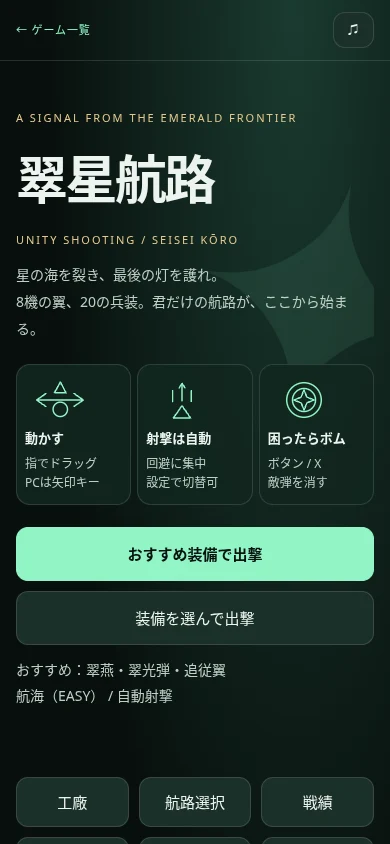
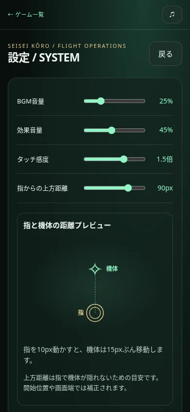
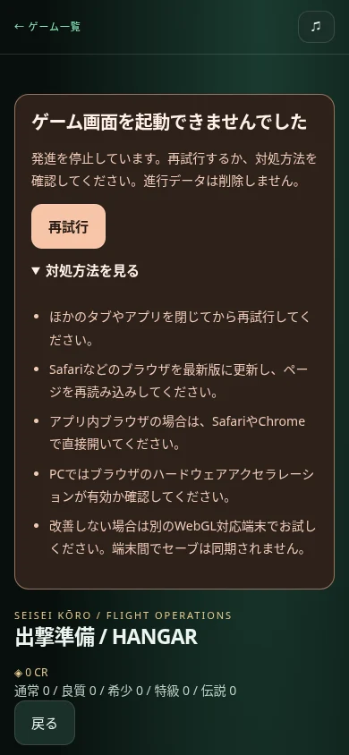

# 出撃・説明・設定の改善（2026-10-28）

ユーザーから受け取った10項目を実装。戦闘バランス、core/combat/balance/save、他ゲームのソースは変更なし。シミュレーション版1.2.0と進行保存を維持し、1.2.0リプレイも引き続き再生可能。

| 項目 | 対応 |
|---|---|
| 起動エラーからの復帰 | WebGL初期化失敗時、発進・おすすめ出撃・リプレイを無効化。再試行と折りたたみの対処方法を表示。Canvasを作り直して描画資産を再生成する。繰り返し失敗しても警告を重複追加しない。 |
| プレイ中の描画停止 | 標準のcontextlostイベントで停止。復旧前の再開を防ぐ。復旧後は同じゲーム状態から再開。リザルト中の停止も結果画面を復元し報酬を二重加算しない。 |
| 簡単スタート | タイトルの「おすすめ装備で出撃」で翠燕・翠光弾・追従翼・航海（EASY）・自動射撃。詳細な装備選びは任意。保存済みの装備選択や自動射撃設定を上書きしない。 |
| 短い操作説明 | 最初に3枚の図解：動かす／射撃は自動／ボム。PC/スマホの詳細、強化、任務、保存は折りたたみに分割。 |
| 機体の視覚比較 | 実ゲームと同じ描画関数から8種類の固有プレビューを生成。特徴タグと基礎耐久・機動・火力の比較バー。重複した旧数値バッジを削除。 |
| 装備一覧 | 発進直前に機体・主兵装・支援機・難度をまとめて表示。スコア/デイリーは実際に出撃する初期の固定装備を示す。 |
| 任務別説明 | 選択中の任務の目的・条件だけを直下に表示。変更時にもセレクトのフォーカスを維持。 |
| 難度の統一 | 選択・任務説明・装備一覧・操作説明・戦績で「標準（NORMAL）」形式。固定任務では難度を自動表示し変更不可とする。 |
| 設定の単位 | 音量は％、感度は倍、上方距離はpx。距離プレビューと、指10pxのドラッグに対する移動量を表示。 |
| 補足文字 | 主な説明を14px・明るい文字色へ。未購入機体全体の透過を解除し比較しやすくする。代表パレットのコントラストを計算。 |
| 画面の情報整理 | 資金・素材は工廠/出撃準備に表示し、説明・設定から除去。 |

## 検証

- `npm test`：347件成功、失敗0。
- `python test/shooting-usability_browser.py`：WebGLを意図的に失敗させ、発進無効・再試行失敗・再試行成功を確認。実際のWEBGL_lose_context拡張でプレイ中/結果中の描画喪失と復旧を検証。結果復旧後の資金非重複も確認。
- おすすめ出撃の実装備と難度、自動射撃ON、既存設定を上書きしないことを確認。
- 8種類の異なる機体画像、24本の性能バー、特徴タグ、任務別文言、固定装備表示、難度表記、設定の表示単位・保存を確認。
- 上方距離90pxの設定時、プレビュー中心間の実CSSピクセル差90pxを測定。
- 375/390/414px幅でタイトル・出撃準備・説明・設定の横はみ出しなし。スクリーンショットを保存。
- 既存ブラウザ統合：工廠開発と保存、キーボード、実タッチドラッグ、手動射撃、精密移動、一時停止、次航路、完全一致リプレイ、リプレイ報酬なし、保存拒否時のプレイ継続を再確認。
- コントラスト：代表の通常/選択カード・設定背景の指定色に対し、相対輝度から5.94〜10.15。サイト全体の全ピクセルや無効コントロールの適合を保証する検査ではない。
- Chromium＋ソフトウェアGPUで検証。物理iPhone/Safari実機は未確認。

描画失敗の検証ではブラウザページ内だけでWebGLを一時的に失敗させている。本番サーバーや他利用者の設定は変更しない。

## 主な変更ファイル

- `public/shooting/menu-ui.js`：メニュー部品・説明・比較・設定表示。
- `public/shooting/main.js`：起動/復旧とUI連携。
- `public/shooting/renderer.js`：既存機体アートを再利用するプレビュー出力のみ追加。
- `public/shooting/index.html`、`style.css`：警告用領域とレイアウト。
- `test/shooting-usability_browser.py`：新しい導線と起動復旧の実ブラウザ検証。

[検証データと画像](qa/usability/)

